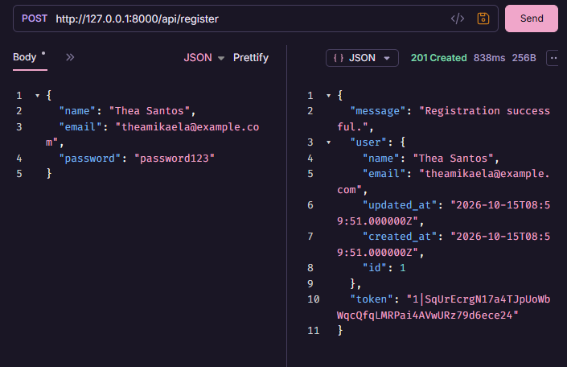
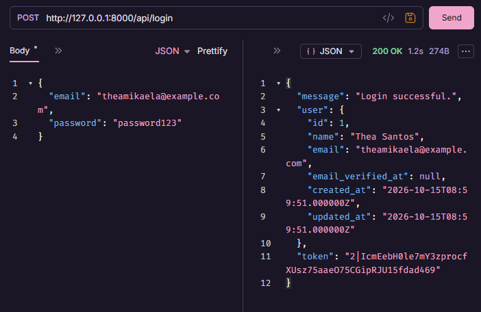
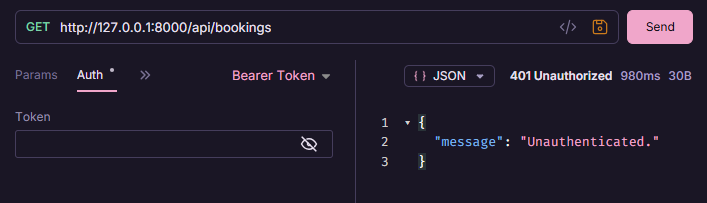
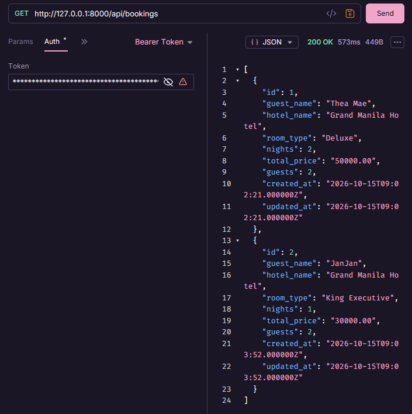
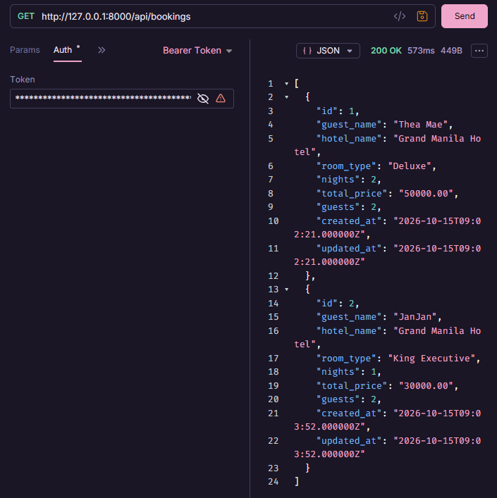
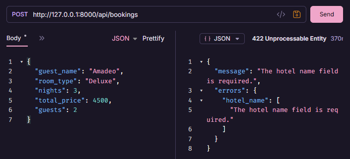
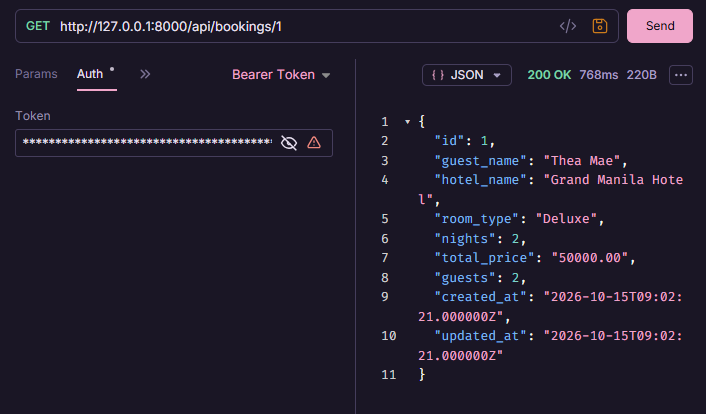
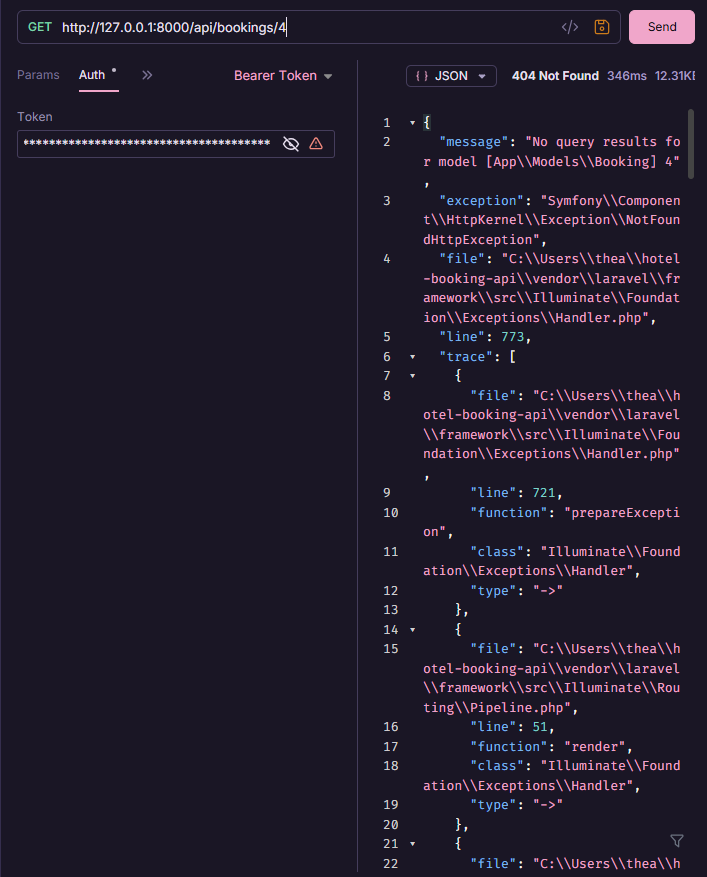
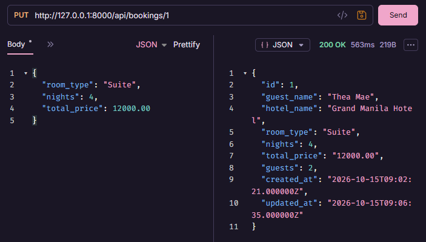
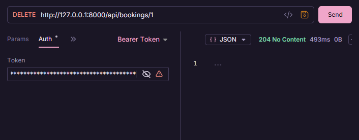

# CIT 3102 — MIDTERM ACTIVITY 2

## BUILD YOUR OWN API

**Name:** Thea Mikaela S. Santos  
**Year & Section:** 3rd Year - IT3E  
**Chosen Resource:** Hotel Booking

---

## Project Setup

The Hotel Booking API is a Laravel project that enables users to create an account, log in, and manage their hotel booking data. Users can add, view, edit, filter, and delete hotel booking information. The project uses SQLite to store booking data and Laravel Sanctum to secure API routes that require authentication. Bruno is used to test the API.

### Technologies Used

- PHP
- Laravel
- SQLite
- Laravel Sanctum
- Bruno

---

## Installation Setup

### Step 1: Clone the repository

```bash
git clone https://github.com/miksley/CIT3102-M5-HOTEL-BOOKING.git
cd CIT3102-M5-HOTEL-BOOKING
```

### Step 2: Install the dependencies

```bash
composer install
```

If Composer is not installed globally, use your Composer PHAR file.

### Step 3: Set up the environment file

Copy `.env.example` to `.env` if the file does not already exist.

```bash
copy .env.example .env
```

Generate the application key:

```bash
php artisan key:generate
```

### Step 4: Configure the database

Set the database connection in `.env`:

```env
DB_CONNECTION=sqlite
```

Make sure the SQLite database file exists at `database/database.sqlite`.

### Step 5: Run the migrations

```bash
php artisan migrate
```

This creates the database tables needed by the application.

### Step 6: Start the Laravel server

```bash
php artisan serve
```

The API will be available at:

`http://127.0.0.1:8000`

Keep the terminal open while testing the API.

---

## API Routes

The base URL is `http://127.0.0.1:8000/api`.

| Verb | Path | Description | Token Required |
|---|---|---|---|
| POST | `/register` | Creates a new user account | No |
| POST | `/login` | Checks login details and returns a token | No |
| GET | `/me` | Gets the currently authenticated user | Yes |
| POST | `/logout` | Logs out the user by revoking the current token | Yes |
| GET | `/bookings` | Gets all bookings and supports filtering | Yes |
| POST | `/bookings` | Creates a new hotel booking | Yes |
| GET | `/bookings/{id}` | Gets one booking using its ID | Yes |
| PUT | `/bookings/{id}` | Updates an existing booking | Yes |
| DELETE | `/bookings/{id}` | Deletes a booking using its ID | Yes |

### Booking Fields

- **guest_name** - Name of the guest
- **hotel_name** - Name of the hotel
- **room_type** - Type of room booked
- **nights** - Number of nights booked
- **total_price** - Total price of the booking
- **guests** - Number of guests

### Filtering Bookings

- `GET /api/bookings?room_type=Deluxe` – Filters bookings by room type.
- `GET /api/bookings?nights=3` – Filters bookings by number of nights.

Both filtering requests require a valid Bearer Token.

---

## Bruno Testing Screenshots

The following screenshots show the API requests and their corresponding responses tested in Bruno.

### 1. Register



### 2. Login



### 3. Get Bookings With No Token



### 4. Get Bookings With Token



### 5. Create Booking With Valid Data



### 6. Create Booking With a Required Field Missing



### 7. Get One Booking



### 8. Get a Non-Existing Booking



### 9. Update Booking With Changed Data



### 10. Delete Booking



---

## Why Does DELETE Return 204 Instead of 200?

A 204 No Content status indicates that the request was successful, but the server does not return any response body. A 200 OK status also indicates a successful request, but it usually includes a response body, such as a confirmation message. If a booking is deleted successfully, our API returns 204 No Content because the record has been deleted from the database, so no additional confirmation message is needed. That is why a 204 status is used for a DELETE request.